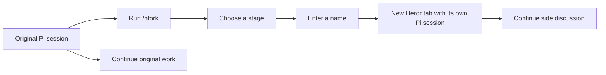

# pi-herdr-session-fork

Open a side conversation from any stage of a [Pi](https://pi.dev) session in a new [Herdr](https://herdr.dev) tab. Your original session stays active, and focus stays in your current tab.

One slash command, a stage picker, and a name prompt. No runtime dependencies beyond Pi and Herdr.

## Install from Git

```bash
pi install git:github.com/1am2syman/pi-herdr-session-fork
```

Then run `/reload` in an existing Pi session, or start a new one.

For a project-only installation:

```bash
pi install --local git:github.com/1am2syman/pi-herdr-session-fork
```

Alternatively, clone the repository and install the local package:

```bash
git clone https://github.com/1am2syman/pi-herdr-session-fork.git
pi install ./pi-herdr-session-fork
```

If you previously copied `herdr-fork.ts` into `~/.pi/agent/extensions/`, move that standalone copy out of the extensions directory before installing this package, so `/hfork` is registered only once.

## Use it

In Pi, running inside a Herdr terminal:

```text
/hfork
```

1. Choose **Current stage (latest)** or an earlier user message.
2. Enter a name for the side conversation.
3. Switch to the new Herdr tab whenever you want to continue the discussion.

The name becomes both the Pi session name and the Herdr tab label. The new Pi process opens ready for your input; it does not automatically send a prompt. Escape cancels either dialog. An empty name also cancels.



## What gets copied?

The extension copies the selected prefix of the **active conversation branch** into a new session file, with a fresh ID and a link to the parent session.

| Selection | History in the new session |
| --- | --- |
| Current stage (latest) | The active branch captured when `/hfork` starts |
| An earlier user message | History through and including that message; later replies and messages are excluded |

For example, given this conversation:

```text
You: Design the API
Pi: Here is the design
You: Implement it
Pi: Implementation details
```

Selecting **Through user message: Implement it** copies the first three entries. The later implementation response is excluded. You can then type a new message in the side session. The selected message is already in its history; it is not placed back in the editor.

| Original session | Side session |
| --- | --- |
| Keeps its existing session file and active conversation | Gets a separate session file and Pi process |
| Can continue independently | Waits for your input in the new tab |
| Receives no automatic updates from the fork | Receives no later messages from the original |

Both sessions use the **same working directory and files**. This extension forks conversation history; it does not create a Git worktree, copy project files, or roll back file edits.

## Requirements and behavior

- Pi interactive terminal mode inside Herdr (`HERDR_ENV=1`).
- `pi` and `herdr` available on `PATH`.
- A saved conversation with at least one entry; sessions started with `--no-session` cannot be forked.
- Pi session format version 3. The extension checks the version before writing a fork.
- Herdr CLI support for `tab create` and `agent start --kind pi`.

The new tab opens without taking focus. The original session is never switched or written to by the extension. The fork is stored next to its source session, including when you use a custom session directory.

If a launch fails, the error reports any created tab and fork path. These are preserved for inspection because a launch timeout can occur after a process has started. Check the reported tab before retrying.

`/hfork` creates a snapshot from recorded session entries. It does not duplicate an in-flight model request, tool execution, background job, or server.

## Update or remove

For the Git-source installation:

```bash
pi update --extensions
pi remove git:github.com/1am2syman/pi-herdr-session-fork
```

Run `/reload` afterward. For a local clone, use `git pull` inside the clone to update it. Removing the extension leaves previously created conversation files intact.

## Verification

Tested with Pi 1.3.0 in real Herdr tabs:

- The live slash command displayed the stage picker and name prompt.
- Selecting an earlier stage copied that history and excluded later messages.
- The fork used a different session file and recorded its parent.
- Session and tab names matched, including spaces and literal shell characters.
- Focus remained unchanged, and the source session continued independently.
- Cancelling either dialog created no fork.
- The new Pi session completed a real model response without changing the source.

The implementation is one TypeScript file: [extensions/herdr-fork.ts](extensions/herdr-fork.ts). Pi loads it directly, so there is no build step.

## License

[MIT](LICENSE)
