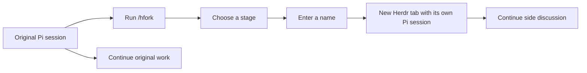

# pi-herdr-session-fork

Open a side conversation from any stage of a [Pi](https://pi.dev) session in a new **herdr-app** tab, powered by **herdr-core** (`hc`). Your original session stays active, and focus stays in your current tab.

One slash command, a stage picker, and a name prompt. No additional runtime packages beyond Pi, herdr-core, and herdr-app.

## Herdr support

This extension supports the current [Herdr](https://herdr.dev) stack:

| Component | Role |
| --- | --- |
| **herdr-core** (`hc`) | Starts and keeps the fork’s Pi terminal running independently of the original terminal |
| **herdr-app** | Displays the fork in a named tab in the original session’s space |

Both components are required. Run Pi inside a herdr-app tab backed by herdr-core, with `pi`, `hc`, and `herdr-app` on `PATH` and the app running on the same machine as Pi. The legacy `herdr` multiplexer is not supported by this version.

## Install from Git

```bash
pi install git:github.com/1am2syman/pi-herdr-session-fork
```

Then run `/reload` in an existing Pi session, or start a new one.

For a project-only installation:

```bash
pi install --local git:github.com/1am2syman/pi-herdr-session-fork
```

Alternatively, clone the repository and install the local package:

```bash
git clone https://github.com/1am2syman/pi-herdr-session-fork.git
pi install ./pi-herdr-session-fork
```

If you previously copied `herdr-fork.ts` into `~/.pi/agent/extensions/`, move that standalone copy out of the extensions directory before installing this package, so `/hfork` is registered only once. Then run `/reload`.

If `/hfork` still reports **“requires Pi running inside Herdr”** after upgrading, Pi is running the old extension. Check for a standalone copy in `~/.pi/agent/extensions/`, move it outside that directory, install or update the package, and run `/reload` again.

## Use it

In interactive Pi, running inside a herdr-app tab backed by herdr-core:

```text
/hfork
```

1. Choose **Current stage (latest)** or an earlier user message.
2. Enter a name for the side conversation.
3. Switch to the new Herdr tab whenever you want to continue the discussion.

The name becomes both the Pi session name and the Herdr tab label. The new Pi process opens ready for your input; it does not automatically send a prompt. Escape cancels either dialog. An empty name also cancels.



## What gets copied?

The extension copies the selected prefix of the **active conversation branch** into a new session file, with a fresh ID and a link to the parent session.

| Selection | History in the new session |
| --- | --- |
| Current stage (latest) | The active branch captured when `/hfork` starts |
| An earlier user message | History through and including that message; later replies and messages are excluded |

For example, given this conversation:

```text
You: Design the API
Pi: Here is the design
You: Implement it
Pi: Implementation details
```

Selecting **Through user message: Implement it** copies the first three entries. The later implementation response is excluded. You can then type a new message in the side session. The selected message is already in its history; it is not placed back in the editor.

| Original session | Side session |
| --- | --- |
| Keeps its existing session file and active conversation | Gets a separate session file and Pi process |
| Can continue independently | Waits for your input in the new tab |
| Receives no automatic updates from the fork | Receives no later messages from the original |

Both sessions use the **same working directory and files**. This extension forks conversation history; it does not create a Git worktree, copy project files, or roll back file edits.

## Requirements and behavior

- Pi interactive terminal mode in a terminal managed by herdr-core (`HC_TERMINAL_ID` is set) and shown in a herdr-app space.
- `pi`, `hc`, and `herdr-app` available on `PATH`, with the app running on the same machine as Pi.
- A saved conversation with at least one entry; sessions started with `--no-session` cannot be forked.
- Pi session format version 3. The extension checks the version before writing a fork.

The extension reads the current terminal’s `herdr.space` label through `hc get`, starts a separate Pi terminal through `hc run --bg`, and lets herdr-app adopt it into a new tab in that space. It names the tab through `herdr-app do tab.rename`. The new tab opens without taking focus, even if another space is currently selected. The side conversation survives the original terminal closing.

The original session is never switched or written to by the extension. The fork is stored next to its source session, including when you use a custom session directory. The legacy `herdr` CLI and `HERDR_ENV` / `HERDR_WORKSPACE_ID` variables are no longer used. Running `/hfork` on a remote machine whose app runs elsewhere is not supported.

If a launch fails, the error reports the fork path and any assigned terminal name and tab ID. These are preserved for inspection because a launch timeout can occur after a process has started. Check `hc get <reported-terminal-name>` and the app before retrying; launches and renames are never automatically retried.

`/hfork` creates a snapshot from recorded session entries. It does not duplicate an in-flight model request, tool execution, background job, or server.

## Update or remove

For the Git-source installation:

```bash
pi update --extensions
pi remove git:github.com/1am2syman/pi-herdr-session-fork
```

Run `/reload` afterward. For a local clone, use `git pull` inside the clone to update it. Removing the extension leaves previously created conversation files intact.

## Verification

Development requires Node.js 22.18+ and npm:

```bash
npm ci
npm test
npm run typecheck
```

The regression suite checks active-branch and earlier-stage history, unchanged source files, cancellation, literal shell characters in names, delayed app adoption, and recovery after CLI or launch failures. It uses simulated CLI responses and creates no Herdr tabs.

With `hc` and `pi` installed, also run:

```bash
npm run test:core
```

This integration check starts a real Pi process in an isolated herdr-core session with scratch config and state, verifies its arguments and independence from the source terminal, then cleans up that session. The app responses are simulated; it does not change the running Herdr window.

For a manual app check, run `/hfork` from a saved conversation in herdr-app. Confirm that the new tab appears in the source space with the requested name, focus stays where it was, and the fork is ready for input. Repeat with an earlier stage and cancel each dialog once.

The implementation is one TypeScript file: [extensions/herdr-fork.ts](extensions/herdr-fork.ts). Pi loads it directly, so there is no build step.

## License

[MIT](LICENSE)
